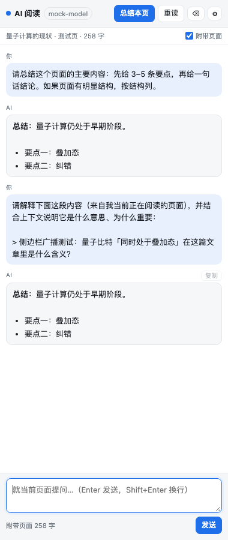
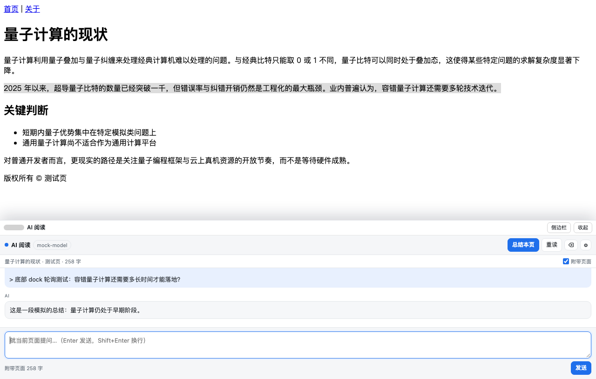

# AI 阅读助手 · 浏览器侧边栏

在阅读网页时随时提问、划词追问、一键总结整页，回答可一键复制，并接入**你自己的大模型**。
默认以 Chrome 原生**右侧边栏**呈现，打开即用；如果更喜欢「整页 + 底部抽屉」的布局，也可以在 ⚙ 设置里切换为可选的**页面底部悬浮面板**。

零依赖、零后端、无埋点：所有模型请求由浏览器直接发往你自己填写的 Base URL，API Key 只保存在本机 profile。



---

## 目录

- [两种呈现方式：默认侧边栏 / 可选底部面板](#两种呈现方式默认侧边栏--可选底部面板)
- [功能](#功能)
- [快速开始](#快速开始)
- [配置模型](#配置模型)
- [使用指南](#使用指南)
- [隐私与权限](#隐私与权限)
- [常见问题 FAQ](#常见问题-faq)
- [架构与设计](#架构与设计)
- [开发与测试](#开发与测试)
- [已知限制](#已知限制)
- [Roadmap](#roadmap)
- [版本历史](#版本历史)
- [许可](#许可)

---

## 两种呈现方式：默认侧边栏 / 可选底部面板

默认呈现方式是 Chrome 原生的 **右侧边栏**：点一下工具栏图标（或按 `Alt+Shift+A`）即可打开，基于 `chrome.sidePanel`（Chrome 116+ / Edge 114+），打开面板本身不依赖内容脚本，路径更短、也更稳定。

Chrome 的 `sidePanel` API 只能把面板固定在浏览器**右侧**，没有提供底部/顶部位置。因此「页面底部悬浮」保留为一个**可选项**（⚙ → 面板位置 → 页面底部悬浮）：适合想要更宽的对话区、或希望一边看整页一边追问的阅读场景。

| 呈现方式 | 位置 | 依赖 | 代价 |
|---|---|---|---|
| 浏览器右侧栏（默认） | 浏览器右侧，固定 | `chrome.sidePanel` | 位置不可自定义，不能贴底 |
| 页面底部悬浮（可选） | 页面底部，可拖拽高度 | 内容脚本 + iframe | 受限页面无法注入时回退侧边栏；极少数严格 CSP 站点 iframe 可能空白 |

底部模式是这样实现的：

1. 内容脚本在页面底部注入一个 **dock**（Shadow DOM 隔离样式，不污染站点、不挤压页面布局）
2. dock 内用 **iframe 加载扩展自己的对话页**（`sidepanel/index.html?embed=bottom`），因此对话、设置、流式渲染全部复用同一套代码
3. 拖动 dock 顶部横条可调高度（220px ~ 85% 视口），`Esc` 或「收起」关闭
4. 在 ⚙ 设置里可切回「浏览器右侧栏」，两种模式可以同时打开并共享最近一次对话

### 可选：页面底部悬浮



> 提示：底部模式依赖内容脚本，`chrome://` 内部页、扩展商店等无法注入的页面会自动回退到原生侧边栏。

---

## 功能

| 功能 | 说明 |
|---|---|
| 浏览器右侧栏 | 默认模式，基于 `chrome.sidePanel` 固定在浏览器右侧（Chrome 116+ / Edge 114+） |
| 底部悬浮面板 | 可选模式，页面底部展开，可拖拽高度，`Alt+Shift+A` 或工具栏图标开关 |
| 划词即问 | 选中文字 → 浮出「问 AI」→ 自动打开当前呈现方式的面板并带着选区追问 |
| 右键菜单 | 「用 AI 解读选中内容」「用 AI 总结本页」 |
| 整页总结 | 启发式正文提取（`article/main` 优先，段落密度兜底，剔除导航/页脚/脚本） |
| 多轮对话 | 流式输出、中途可停止；最近一次对话保存在本机，关闭后重新打开可恢复 |
| 复制回答 | 每条回答右上角「复制」按钮，一键复制原始 Markdown（侧边栏与底部面板都可用） |
| 完全 BYOK | 兼容 `POST {BaseURL}/chat/completions`，任何 OpenAI 兼容服务 |
| 连接自检 | 设置里点「测试连接」，直接看到 HTTP 状态与错误原因 |
| 省 token | 顶栏「附带页面」开关；「页面正文上限」可配置 |
| 设置同步 | 侧边栏与底部面板同时打开时，配置改动实时同步 |

---

## 快速开始

1. 确认 Chrome ≥ 116，打开 `chrome://extensions`
2. 右上角打开 **开发者模式**
3. 点 **加载已解压的扩展程序**，选择本仓库的 **`extension/`** 目录
4. 把扩展图标固定到工具栏，点一下（或按 `Alt+Shift+A`）→ 浏览器右侧打开 AI 侧边栏
5. 点面板里的 **⚙** → 填写 Base URL / API Key / 模型名 → 保存 → 点「测试连接」

> 想改用页面底部悬浮：⚙ → 面板位置 → 页面底部悬浮，当前页底部会直接展开；之后点工具栏图标或按 `Alt+Shift+A` 即可开关。

---

## 配置模型

插件只要求服务兼容 OpenAI 的 `/chat/completions` 协议。常用配置：

| 服务 | Base URL | 模型名 | 备注 |
|---|---|---|---|
| DeepSeek | `https://api.deepseek.com/v1` | `deepseek-chat` | 最省，日常阅读够用 |
| Ollama（本地） | `http://localhost:11434/v1` | `qwen3:8b` | API Key 随便填（如 `ollama`），Ollama 不校验 |
| OpenAI | `https://api.openai.com/v1` | `gpt-4o-mini` | |
| 硅基流动 | `https://api.siliconflow.cn/v1` | `deepseek-ai/DeepSeek-V3` | 国内直连 |
| 通义 / Kimi / OpenRouter | 对应官方 OpenAI 兼容地址 | 按服务商文档 | 同上 |
| one-api / LiteLLM / New API | `http://127.0.0.1:3000/v1` | 网关里配置的名字 | 想同时接多家时用这个 |

小提示：

- 填了 `…/v1/chat/completions` 也能用，代码会自动剥掉多余路径；结尾斜杠无所谓
- 走自建网关时，可以把 DeepSeek / Claude / 本地模型统一转成 OpenAI 协议，插件只填网关地址
- 本地 Ollama：若浏览器请求被 CORS 拒绝，启动时加上 `OLLAMA_ORIGINS=*` 即可

### 可调参数

| 参数 | 默认 | 说明 |
|---|---|---|
| 温度 | 0.3 | 总结类任务建议 0.2~0.4 |
| 页面正文上限 | 40000 字 | 超长页面按此截断，降低 token 成本 |
| 系统提示词 | 内置阅读助手提示 | 可改成你自己的风格与约束 |
| 面板位置 | 浏览器侧边栏（推荐） | 可切「页面底部悬浮」，切换即时生效 |

---

## 使用指南

| 操作 | 方式 |
|---|---|
| 打开右侧边栏（默认） | 点工具栏图标或按 `Alt+Shift+A` |
| 切换呈现方式 | ⚙ → 面板位置 → 浏览器侧边栏 / 页面底部悬浮，保存后即时生效（切到底部会在当前页展开） |
| 展开 / 收起底部面板（可选） | 点工具栏图标、`Alt+Shift+A`，或面板上的「收起」；`Esc` 也可收起 |
| 调整底部面板高度 | 拖动面板顶部横条（220px ~ 85% 视口） |
| 切回右侧栏 | ⚙ → 面板位置 → 浏览器侧边栏；底部面板顶栏的「侧边栏」按钮也可直接切回（会把面板位置改回浏览器侧边栏） |
| 翻译页面正文 | 面板顶栏「翻译本页」。将当前页面可读取的正文（受「页面正文上限」限制）发给已配置的模型，译文以简体中文显示在对话中，不替换网页原文。此按钮不改变「附带页面」开关。 |
| 总结整页 | 面板顶栏「总结本页」，或页面右键 →「用 AI 总结本页」 |
| 追问某段 | 选中文字 → 浮出「问 AI」；或右键「用 AI 解读选中内容」 |
| 自由提问 | 面板输入框，Enter 发送，Shift+Enter 换行 |
| 换页面 | 自动跟随当前标签页；必要时点「重读」 |
| 清空对话 | 点击面板顶栏「清空」，删除历史和此前对话上下文，不改变设置或当前「附带页面」开关状态 |
| 复制回答 | 鼠标移到回答上（或键盘聚焦）→ 回答右上角「复制」；复制的是原始 Markdown，粘贴到文档里保留标题/列表/代码块格式 |

切到底部模式后，打开面板的方式不变：点工具栏图标 / `Alt+Shift+A`，或用划词、右键菜单触发；受限页面注入不了内容脚本时会自动回退到右侧边栏。两种呈现方式也可以同时打开，共用同一份配置和最近一次对话；关闭后重新打开面板会恢复本机保存的对话。

典型流程：

1. 打开一篇长文，面板顶栏显示「标题 · N 字」
2. 点「总结本页」→ 收到 3~5 条要点 + 一句话结论
3. 选中看不懂的段落 → 点「问 AI」→ 面板自动追问这段
4. 接着在输入框继续追问，模型记得上文与页面正文
5. 回答满意就点回答右上角的「复制」，直接粘贴到笔记 / 文档里

---

## 隐私与权限

- **无中转**：请求由扩展页面直接 `fetch` 到你填的 Base URL，没有作者服务器、没有统计上报
- **Key 存放**：`chrome.storage.local`，即本机 Chrome profile（明文）。公用电脑请自行留意
- **面板内容**：右侧边栏与底部面板都是扩展自己的 `chrome-extension://` 页面，网页脚本读不到对话内容
- **权限清单**：
  - `sidePanel`、`contextMenus`、`storage`、`activeTab`：侧边栏、右键菜单、存配置
  - `clipboardWrite`：回答的「复制」按钮写入剪贴板（仅在你点击按钮时写入，不读取剪贴板内容；打包安装时 Chrome 会提示「修改你复制和粘贴的数据」，这是该权限的标准提示，用于保证底部 iframe 里也能写入）
  - `host_permissions: <all_urls>`：注入正文提取 / 划词浮层（以及底部模式的 dock）；以及让扩展页面跨域请求你填的 API
  - `web_accessible_resources`：仅底部悬浮模式需要，让 dock 的 iframe 能加载扩展自己的页面（仅限扩展文件）
  - `scripting`：预留给按需注入（当前未使用）
- 插件本身不做任何远程配置拉取，代码可自行审计

---

## 常见问题 FAQ

**Q：点图标没反应 / 面板不出现？**
先到 `chrome://extensions` 点扩展的刷新按钮（改代码后必须重载）。默认应打开浏览器右侧栏；如果当前是底部模式，且页面是 `chrome://`、Chrome 应用商店等受限页面，内容脚本无法注入，此时会自动回退到右侧栏。

**Q：如何切换面板位置？**
⚙ → 面板位置 → 「浏览器侧边栏」或「页面底部悬浮」，保存后即时生效。

**Q：切到页面底部悬浮后，怎么打开面板？**
切换后会在当前页底部直接展开；之后点工具栏图标或按 `Alt+Shift+A` 开关，划词后点「问 AI」、右键菜单也会打开底部面板。受限页面会自动回退到右侧栏。

**Q：底部面板一片空白？**
极少数网站的严格 CSP 可能拦截扩展 iframe。⚙ → 面板位置 → 浏览器右侧栏 即可；也可先刷新页面重试。

**Q：为什么默认是右侧边栏，而不是底部面板？**
`chrome.sidePanel` 是浏览器原生能力，打开面板本身不依赖内容脚本，更稳定；底部悬浮作为可选项，留给想要「整页 + 底部抽屉」布局的场景。

**Q：提示 HTTP 401？**
API Key 无效、过期或没有该模型权限。检查 Key 是否复制完整、是否还需要在服务商控制台开通模型。

**Q：提示 HTTP 404？**
Base URL 少了或多了 `/v1`。比如 DeepSeek 需要 `https://api.deepseek.com/v1`，有的网关则不带 `/v1`。

**Q：顶栏显示「无法读取正文」？**
内嵌 PDF、`chrome://` 页面、部分 Canvas 渲染页取不到正文。可以手动把内容粘贴到输入框提问。

**Q：划词后没有浮出「问 AI」？**
页面内嵌 iframe 中的文字、或 Canvas 渲染的文字无法被顶层文档选中；另外选中状态会在滚动时自动隐藏按钮。

**Q：为什么每轮都带整页正文？会不会很贵？**
默认带上是为了让追问有上下文。闲聊或算力紧张时关掉顶栏「附带页面」；也可以把「页面正文上限」调小。

**Q：可以同时开底部面板和右侧栏吗？**
可以，两处共用同一份配置和最近一次对话。

**Q：回答的「复制」按钮在哪？复制失败怎么办？**
鼠标移到 AI 回答上（或键盘聚焦面板），回答右上角会出现「复制」；点击后按钮短暂显示「已复制」，复制的是原始 Markdown。若显示「复制失败」，通常是剪贴板权限或系统剪贴板不可用：可先手动选中回答文字复制，或切到浏览器右侧栏再试（底部悬浮是跨域 iframe，少数站点会限制剪贴板写入）。

**Q：支持哪些浏览器？**
Chromium 系（Chrome / Edge / Brave / Vivaldi）。Firefox 没有 `sidePanel` API，Safari 不支持 MV3 侧边栏。

**Q：数据会不会被作者收集？**
不会。作者没有服务器；你填的 Base URL 是唯一出口。担心的话全局搜索代码里的 `fetch(` 即可核对。

---

## 架构与设计

```
浏览器
 ├─ 右侧原生边栏（默认，chrome.sidePanel）
 │    └─ sidepanel/（扩展页面，侧边栏与 dock 共用）
 │         ├─ 设置（chrome.storage.local）
 │         ├─ 上下文拼装（系统提示词 + 页面正文 + 会话历史）
 │         └─ lib/openai.js（SSE 流式客户端）
 │              │  fetch → 你的 Base URL
 │              ▼
 │          模型服务（DeepSeek / Ollama / 网关…）
 │
 └─ 网页标签页
      └─ content.js（隔离世界）
           ├─ 正文提取（article/main 优先 → 段落密度兜底）
           ├─ 划词浮层（Shadow DOM，防站点样式污染）
           └─ 底部 dock（Shadow DOM + iframe，可选底部模式）
```

```
browser-ai-sidebar/
├── extension/                 # ← 加载这个目录
│   ├── manifest.json          # MV3：sidePanel（默认）、可选底部 dock、web_accessible_resources
│   ├── background.js          # 面板分发（默认 side / 可选 bottom）、右键菜单、消息转发
│   ├── content.js             # 正文提取 + 划词浮层 + 可选底部 dock
│   ├── lib/
│   │   ├── openai.js          # 纯函数：Base URL 规范化、SSE 解析、错误格式化
│   │   ├── markdown.js        # 纯函数：先转义再渲染的安全 Markdown
│   │   └── clipboard.js       # 纯函数：Clipboard API 优先 + execCommand 兜底
│   ├── sidepanel/
│   │   ├── index.html         # 对话页（侧边栏 + 底部 dock iframe 共用）
│   │   ├── sidepanel.js       # 状态、上下文、流式渲染、回答复制、设置
│   │   └── style.css
│   └── icons/
├── test/
│   ├── stream.test.mjs        # SSE / 错误 / Abort
│   ├── markdown.test.mjs      # XSS 转义与渲染
│   ├── clipboard.test.mjs     # 复制：Clipboard API / execCommand 兜底
│   ├── settings.test.mjs      # 默认配置 / manifest 版本与权限
│   └── smoke-chrome.mjs       # headless Chrome 端到端冒烟
├── docs/
│   ├── side-panel.png         # 默认：浏览器右侧栏
│   └── bottom-dock.png        # 可选：页面底部悬浮
└── package.json
```

设计取舍：

- **默认走原生 `chrome.sidePanel`**，不依赖内容脚本，打开路径更短、更稳定；底部 dock 作为可选增强，通过 iframe 复用同一套 UI
- **网络客户端、渲染逻辑与剪贴板写入抽成纯函数**（`lib/*.js`），因此可以脱离浏览器直接在 Node 里单测
- **content script 不发任何网络请求**，页面内容只通过消息传给扩展自身
- **Markdown 先整体转义再套格式**，模型输出里的 HTML/脚本不会执行
- **复制的是原始 Markdown 而不是渲染后的 DOM 文本**，粘贴到文档/笔记里能保留标题、列表、代码块；剪贴板写入优先走 Clipboard API，被权限策略拒绝时退回 `execCommand('copy')`
- **设置只有单一真源**（storage），任何面板改动即时广播

---

## 开发与测试

```bash
npm test        # 24 个单测，纯 Node，无需浏览器
npm run smoke   # 端到端冒烟测试，需要本机 Chrome（macOS 默认路径，可用 CHROME_PATH 覆盖）
SMOKE_SCREENSHOT=docs/bottom-dock.png SMOKE_SIDE_SCREENSHOT=docs/side-panel.png npm run smoke   # 同时生成两张截图
```

**单测**覆盖：SSE 跨 TCP 分片拼接、`[DONE]` 终止、`reasoning_content` 忽略、HTTP 401 可读错误、网关忽略 `stream` 时的 JSON 兜底、Abort 中断、Markdown XSS 转义、代码块隔离、列表/标题/链接渲染、复制回答（Clipboard API 优先、被拒后 execCommand 兜底、空内容不写入）；以及默认配置（面板位置 = 浏览器侧边栏）、manifest 版本 / `side_panel` / `clipboardWrite` 注册、设置项顺序。

**冒烟测试**会起 headless Chrome 真实加载扩展，按 8 步验证「默认侧边栏路由 + 显式切到底部后的 dock 全链路」：

1. 扩展加载（`Extensions.loadUnpacked`）+ `content.js` 注入成功
2. 默认 side：划词浮层出现 → 点「问 AI」→ 不注入底部 dock，background 把选区写入 `pendingSelection`
3. `chrome.tabs.sendMessage(EXTRACT_PAGE)` 拿到正文，导航/页脚被剔除
4. 侧边栏页面加载 → 设置弹窗默认「浏览器侧边栏」→ 切到文章页后显示「标题 · N 字」
5. 点「总结本页」→ 真实 SSE 流式渲染 → 请求体里带了页面正文；回答「复制」按钮复制原始 Markdown（含 `**`/列表标记），并反馈「已复制」，用户消息没有按钮
6. 侧边栏收到 `SELECTION` 广播 → 请求带选区与页面正文
7. 显式切到「页面底部悬浮」（等 background 生效）→ 划词点「问 AI」→ dock 展开，iframe 指向 `sidepanel/index.html?embed=bottom` 且带 `allow="clipboard-write"`，并断言 dock 高度几何（内层≈宿主、≤ 85% 视口）
8. dock 内 iframe 常驻轮询 → 自动带上选区与正文追问；收起后宿主 `display:none`

> 说明：Chrome 137+ 用 `--load-extension` 启动的扩展会进入受限模式（无内容脚本、无 host 权限），因此测试改用 CDP 的 `Extensions.loadUnpacked`（需 `--enable-unsafe-extension-debugging`），与用户在 `chrome://extensions` 手动加载行为一致。手动加载的正常路径不受影响。

> headless 下脚本合成点击不带用户手势，`chrome.sidePanel.open` 会被浏览器拒绝，因此冒烟断言「默认 side 不注入 dock、选区留在 storage」；换成 CDP 真实手势点击时，侧边栏会正常打开并消费选区（该差异已写入测试文件头注释）。

---

## 已知限制

- 仅 Chromium 系浏览器；Firefox / Safari 无对应 MV3 侧边栏能力
- 默认的浏览器右侧栏位置固定，不能贴左 / 贴底
- 可选的底部悬浮依赖内容脚本，受限页面自动回退右侧栏；极少数 CSP 严格站点可能 iframe 空白
- 内嵌 PDF、Canvas 渲染页面读不到正文
- 超长页面按上限截断，细节可能丢失
- 每轮都会带页面正文（可关闭）；成本由你的模型服务商决定
- 划词浮层只作用于顶层文档，嵌套 iframe 内的文字无法选中
- 底部悬浮是跨域 iframe，极少数站点会限制剪贴板写入；「复制」失败时可切回浏览器右侧栏重试

---

## Roadmap

- [ ] 划词浮层内嵌输入框，支持自定义问题而不只是「解释这段」
- [ ] 底部面板（可选）支持贴左/贴右、记住上次高度
- [ ] 多会话
- [ ] 回答中的原文引用可点击跳回页面位置
- [ ] Anthropic 原生协议 / 自定义请求头 / 系统代理
- [ ] 一键导出对话为 Markdown
- [ ] i18n（English）

---

## 版本历史

### v0.4.0

- 新增**回答复制**：每条 AI 回答右上角提供「复制」按钮（鼠标悬停 / 键盘聚焦时出现），一键复制**原始 Markdown**，粘贴到文档、笔记里保留标题、列表、代码块格式；点击后短暂显示「已复制」，失败显示「复制失败」
- 侧边栏与页面底部悬浮面板共用同一套实现；底部 dock 的跨域 iframe 显式放开 `clipboard-write` 权限策略，复制按钮在底部模式同样可用
- 新增 `clipboardWrite` 权限（只在点击按钮时写入剪贴板，不读取剪贴板内容）
- 复制逻辑抽成 `lib/clipboard.js` 纯函数：优先 `navigator.clipboard.writeText`，被权限策略 / 环境拒绝时退回隐藏 textarea + `execCommand('copy')`
- 新增 6 个剪贴板单测（共 24 个）与冒烟断言：复制的是原始 Markdown 而非渲染后文本、用户消息不出现复制按钮、dock iframe 带 `allow="clipboard-write"`
- 重新生成侧边栏截图，展示回答复制按钮
- 版本号升至 0.4.0

### v0.3.0

- **默认呈现方式改为浏览器原生右侧边栏**（`chrome.sidePanel`）：点工具栏图标或 `Alt+Shift+A` 即可打开，打开面板不再依赖内容脚本
- 页面底部悬浮面板改为**可选项**：⚙ → 面板位置 → 页面底部悬浮；仍支持拖拽高度、`Esc` 收起、iframe 复用对话页
- 修复底部面板实际铺满整个视口、拖拽高度不生效的问题（内层面板改为相对 dock 宿主绝对定位），并补冒烟几何回归断言
- 底部面板顶栏的「侧边栏」按钮现在会把「面板位置」设置一并改回浏览器侧边栏，避免下次点图标又回到底部面板
- 受限页面（`chrome://`、扩展商店等）无法注入内容脚本时，底部模式自动回退到右侧边栏
- 同步更新扩展清单与说明：功能表、架构图、权限说明、FAQ 全部对齐新默认
- 冒烟测试覆盖「默认侧边栏路由 + 显式切到底部后的 dock 全链路」，并同时生成侧边栏 / 底部两张截图
- 版本号升至 0.3.0

### v0.2.0

- 新增页面底部悬浮面板：可拖拽高度、`Esc` 收起、iframe 复用对话页
- 新增「面板位置」设置：页面底部悬浮 / 浏览器右侧栏，切换即时生效
- 新增 `web_accessible_resources`
- 新增底部 dock 的选区轮询，划词后常驻面板也能自动接上
- 设置变更在多个面板间实时同步
- 冒烟测试扩展到 7 条链路，支持截图留档

### v0.1.0

- 首个版本：原生侧边栏、划词追问、整页总结、右键菜单、OpenAI 兼容 BYOK、流式输出
- 14 个单测 + 端到端冒烟测试

---

## 许可

仓库暂未附带 License 文件。如需开源发布，建议补一个 MIT LICENSE（可自行添加，或告诉我来加）。
